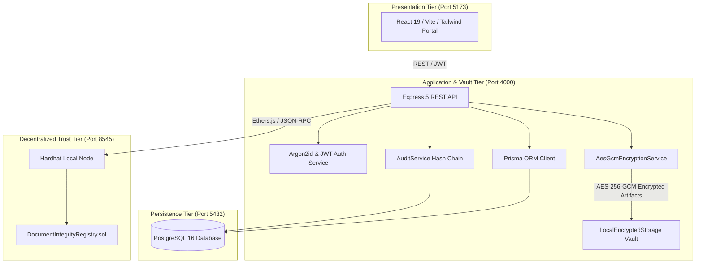

# NyayaVault (न्यायVault)
### Secure Legal Document Management & Cryptographic Integrity Verification System

[](https://www.typescriptlang.org/)
[](https://nodejs.org/)
[](https://www.postgresql.org/)
[](https://soliditylang.org/)
[](https://hardhat.org/)
[](https://react.dev/)
[]()

NyayaVault is an enterprise-grade Digital Evidence and Document Management System (DMS) engineered to safeguard evidentiary chain-of-custody. It combines **authenticated AES-256-GCM local storage encryption**, **SHA-256 canonical plaintext fingerprinting**, a **tamper-evident audit hash chain**, and **immutable on-chain Ethereum smart contract anchoring** to provide mathematically verifiable proof against evidence tampering.

---

## 1. Problem Statement & Purpose

In traditional Document Management Systems (DMS) used across legal, investigative, and judicial workflows, stored files are vulnerable to silent alteration:
1. **Unchecked Storage Access:** Privileged database or system administrators can alter or replace physical evidentiary files on disk without triggering database alerts.
2. **Missing Proof of Authenticity:** Standard relational databases track update timestamps, but cannot independently prove whether file bytes have been subtly modified post-custody.
3. **Vulnerable Custody Logs:** Traditional audit trails stored in mutable database tables can be scrubbed, backdated, or rewritten by insider threats.

**NyayaVault solves this by decoupling trust from mutable storage:**
- Files are encrypted at rest using **AES-256-GCM** immediately upon ingestion.
- Sealing a document computes its authoritative **SHA-256 plaintext digest**, establishes a cryptographically linked **audit event**, and anchors an **immutable proof on an EVM blockchain**.
- Any subsequent verification recalculates the hash from decrypted storage bytes and compares it in real time against both the database record and the immutable on-chain smart contract anchor.

---

## 2. Architecture & Core Workflow



### End-to-End Custody Lifecycle:
1. **Ingestion (Upload):** Officer uploads an evidentiary document under an authorized case. The server validates MIME magic bytes, encrypts the file via **AES-256-GCM** using a fresh 96-bit initialization vector (IV), and writes the encrypted payload to secure vault storage. The document enters **`DRAFT`** status (`NOT_ANCHORED`). Raw unencrypted bytes never touch the disk.
2. **Sealing:** An authorized officer clicks **Seal & Anchor Document**. The vault decrypts the payload internally, computes the canonical **SHA-256 plaintext fingerprint**, creates a `DOCUMENT_SEALED` event in the audit chain, and submits an on-chain transaction to the `DocumentIntegrityRegistry` contract. The status updates to **`SEALED`** and **`ANCHORED`**.
3. **Verification:** Any authorized officer or auditor clicks **Verify Integrity**. The server decrypts the active storage artifact, computes its current SHA-256 digest, queries the smart contract anchor on-chain, and performs a 3-way validation. If matching, the UI renders **`INTEGRITY VERIFIED`**. If any byte was altered, it flags **`TAMPER DETECTED / MISMATCH`**.

---

## 3. Cryptographic & Security Model

| Security Layer | Cryptographic Mechanism | Implementation Detail |
| :--- | :--- | :--- |
| **Storage Confidentiality & Authenticity** | **AES-256-GCM** | Raw documents are encrypted before persistence. Every stored file contains a 12-byte random IV, 16-byte authentication tag, key version identifier, and ciphertext. |
| **Evidentiary Fingerprinting** | **SHA-256** | 256-bit cryptographic digest calculated over canonical plaintext bytes at sealing. |
| **Trustless Proof Anchor** | **EVM Smart Contract** | `DocumentIntegrityRegistry.sol` stores only proof metadata (`documentId`, `versionId`, `documentHash`, `eventType`, `actor`, `timestamp`). **Zero document content, zero PII, and zero encryption keys are stored on-chain.** |
| **Audit Log Integrity** | **Cryptographic Hash Chain** | Each audit log entry calculates `eventHash = SHA256(id + eventType + actorId + documentId + versionId + timestamp + previousEventHash)`. Any deleted or modified event breaks the chain. |
| **Password Storage** | **Argon2id** | Passwords are salted and hashed with Argon2id via `@node-rs/argon2`. Plaintext passwords are never stored. |

> [!IMPORTANT]
> **Evidentiary Integrity vs. Legal Admissibility Disclaimer:**  
> NyayaVault is a technical integrity verification platform that produces mathematically verifiable proof of document authenticity and non-tampering. It **supports evidentiary integrity and verification**. It does **not** claim automatic legal admissibility under Indian Evidence Act Section 65B or equivalent statutory frameworks without requisite certificates of electronic records, human custody affidavits, and applicable institutional procedures.

---

## 4. Technology Stack

- **Frontend:** React 19, TypeScript 5.7, Vite 6, Tailwind CSS 4, React Router 7, TanStack React Query 5, Lucide React, Zod.
- **Backend:** Node.js (v20+), Express 5, TypeScript, Prisma ORM 6, `@node-rs/argon2`, `jsonwebtoken`, `multer`, `ethers` v6.
- **Blockchain:** Solidity 0.8.24, Hardhat 2.22, TypeChain, Ethers.js v6.
- **Database:** PostgreSQL 14+ (Tested on PostgreSQL 16), Prisma Client.

---

## 5. System Prerequisites

Before running NyayaVault on a fresh PC (Windows 10/11, macOS, or Linux), verify the following tools are installed:

| Tool | Minimum Version | Verified Version | Notes |
| :--- | :--- | :--- | :--- |
| **Node.js** | **v20.6.0+** *(LTS 20 or 22)* | `v24.14.0` | **Node 18 is NOT supported.** Native `process.loadEnvFile()` in `backend/` requires Node.js $\ge 20.6.0$. |
| **npm** | **v9.0.0+** | `v11.9.0` | Included with Node.js. |
| **PostgreSQL** | **v14.0+** *(v16 recommended)* | `v16.0` | Native installation or optional Docker. |
| **Git** | **v2.30+** | `v2.55.0` | Standard source control. |

---

## 6. Environment Setup

### 1. Backend Configuration (`backend/.env`)
Copy the backend environment template:
```bash
cp backend/.env.example backend/.env
```
Ensure `backend/.env` contains the required configuration:
```ini
# 32-byte Base64 encryption key (generate with: node -e "console.log(crypto.randomBytes(32).toString('base64'))")
DOCUMENT_ENCRYPTION_KEY=<your-32-byte-base64-key>
DOCUMENT_ENCRYPTION_KEY_VERSION=v1

STORAGE_ROOT_DIR=./storage
PORT=4000

# Blockchain configuration (Hardhat Local Node)
BLOCKCHAIN_RPC_URL=http://127.0.0.1:8545
BLOCKCHAIN_CONTRACT_ADDRESS=<deployed-contract-address-from-step-8>
BLOCKCHAIN_PRIVATE_KEY=<hardhat-account-0-private-key>

# PostgreSQL connection string
DATABASE_URL=postgresql://<user>:<password>@localhost:5432/nyayavault?schema=public

# Authentication secret (32+ character hex string)
JWT_SECRET=<your-32-byte-jwt-secret>
JWT_EXPIRES_IN=15m
```

### 2. Frontend Configuration (`frontend/.env`)
Copy the frontend environment template:
```bash
cp frontend/.env.example frontend/.env
```
Ensure `frontend/.env` is configured for live backend integration:
```ini
VITE_API_BASE_URL=http://localhost:4000/api
VITE_USE_MOCK_API=false
```

---

## 7. Database Setup

### Option A: Native PostgreSQL (Active / Recommended on Host)
1. Verify PostgreSQL service is running on port `5432`.
2. Ensure the `nyayavault` database exists:
   ```bash
   psql -U postgres -c "CREATE DATABASE nyayavault;"
   ```
3. Update `DATABASE_URL` in `backend/.env` with your native PostgreSQL user and password.

### Option B: Optional Docker PostgreSQL (For Fresh Evaluator Machines)
If native PostgreSQL is not installed and Docker Desktop is available, start the containerized service:
```bash
npm run db:docker:up
```
*(To stop later: `npm run db:docker:down`).*

---

## 8. Startup Sequence (Step-by-Step)

The clean startup process uses **3 dedicated terminal windows** to keep ledger, API, and UI logs cleanly separated:

```
+----------------------------------------------------------------------------------------------------+
|                                    TERMINAL 1: BLOCKCHAIN (EVM)                                    |
| 1. npm run chain:node                                                                              |
|    (Keep running in foreground on http://127.0.0.1:8545)                                           |
|                                                                                                    |
| [One-Off Temporary Action while Terminal 1 is running]:                                            |
|    npm run chain:deploy                                                                            |
|    -> Copy printed 'Contract Address: 0x...' into backend/.env (BLOCKCHAIN_CONTRACT_ADDRESS)       |
+----------------------------------------------------------------------------------------------------+
|                                    TERMINAL 2: BACKEND (API & VAULT)                               |
| 1. npm run backend:setup   (Compiles TypeScript + runs Prisma migrations + seeds demo users)       |
| 2. npm run backend:start   (Starts Express server on http://localhost:4000)                        |
+----------------------------------------------------------------------------------------------------+
|                                    TERMINAL 3: FRONTEND (WEB UI)                                   |
| 1. npm run frontend:dev   (Starts Vite dev server on http://localhost:5173)                        |
+----------------------------------------------------------------------------------------------------+
```

---

## 9. Development & Demo Role Accounts

NyayaVault seeds four deterministic development accounts with Argon2id password hashing. For rapid evaluator access, the login screen provides clickable **Demo Role Presets** that automatically autofill credentials:

| Role | Name | Demo Identifier | Demo Password | Authorized Capabilities |
| :--- | :--- | :--- | :--- | :--- |
| **INSPECTOR** | Inspector Sharma | `inspector@nyayavault.local` | `Password@123` | Case Registration, Evidence Upload, Sealing & Anchoring |
| **FORENSIC_OFFICER** | Dr. A. Verma | `forensic@nyayavault.local` | `Password@123` | Case Registration, Evidence Examination, Integrity Verification |
| **AUDITOR** | Auditor K. Patel | `auditor@nyayavault.local` | `Password@123` | Read-Only Audit Logs, Chain-of-Custody Inspection, Integrity Verification |
| **ADMIN** | System Administrator | `admin@nyayavault.local` | `Password@123` | Global System Access, Case Override, Security Auditing |

*Note: These credentials are strictly development presets for testing and demonstration.*

---

## 10. Judge Demonstration Flow (5–10 Minute Runbook)

Follow this golden-path walkthrough during evaluations:

| Time | Presenter Action | What Judges Observe in UI | Technical Under-the-Hood Behavior |
| :---: | :--- | :--- | :--- |
| **00:00** | Open `http://localhost:5173/login`. Click **INSPECTOR** preset button. Click **Authenticate & Enter**. | Navigates to Dashboard. Topbar displays "Inspector Sharma" with role badge and live API endpoint indicator. | Backend verifies Argon2id hash against PostgreSQL, issues signed JWT token containing role claims. |
| **01:30** | Click **Cases** in sidebar $\to$ Click **Register Case**. Enter Title: `State vs Cyber Fraud Syndicate`, FIR: `FIR/2026/101`, Division: `Cyber Crime Branch`. Click **Register Case**. | New case ledger is created and rendered in Case Details view. | Backend stores Case model in PostgreSQL with `ACTIVE` status and associates creator memberships. |
| **03:00** | On Case Details page, click **Upload Document**. Choose a file (e.g. `test_evidence.pdf`). Enter Title: `Seized Hard Drive Forensic Image`. Click **Upload Document**. | Document appears in case list. Status: **`DRAFT`**, Blockchain: **`NOT_ANCHORED`**. | File received via Multer, magic bytes validated, encrypted with AES-256-GCM (fresh 96-bit IV) and saved to disk. |
| **04:30** | Click on the uploaded document. Review the advisory panel. Click **Seal & Anchor Document**. | Button animates. Status updates to **`SEALED`** (Emerald badge), Blockchain updates to **`ANCHORED`**. Plaintext SHA-256 digest and on-chain Transaction ID are displayed. | Server decrypts payload internally, computes canonical SHA-256 hash, emits `DOCUMENT_SEALED` audit event, and submits Ethers.js transaction to `DocumentIntegrityRegistry.sol`. |
| **06:00** | Click **Verify Integrity**. | Panel renders **`INTEGRITY VERIFIED`** (Status: `VERIFIED`) with green shield check icon. | Backend decrypts storage artifact, recomputes SHA-256, verifies match against PostgreSQL record, and confirms match on blockchain. |
| **07:00** | **Controlled Tamper Demonstration** (See Section 11). Copy Document ID. Run tamper script in terminal. Click **Verify Integrity** again. | Panel renders **`TAMPER DETECTED`** (Status: `MISMATCH`) with flashing red alert and side-by-side hash contradiction. | Plaintext bytes extracted from decrypted storage do not match the trusted sealed digest recorded on the blockchain. |
| **08:30** | **Restoration Demonstration** (See Section 12). Run restore script in terminal. Click **Verify Integrity** again. | Panel returns to **`INTEGRITY VERIFIED`** (Status: `VERIFIED`). | Authentic byte-for-byte storage artifact restored from backup. |
| **09:30** | Click **Audit Trail** button on document page. | Chronological audit trail showing unbroken cryptographic hash chain from upload to sealing. | Renders cryptographically chained `AuditEvent` records with SHA-256 event hashes. |

---

## 11. Controlled Tamper Detection Demonstration

To demonstrate physical storage tampering without altering database records or blockchain proofs, a temporary developer utility is provided:

```bash
node backend/scripts/demo/tamper-document.mjs <DOCUMENT_ID>
```

### Safety & Simulation Architecture:
- Creates a byte-for-byte `.bak` backup of the encrypted file.
- Decrypts the artifact, modifies the plaintext bytes, and re-encrypts with the real master key (valid AES-256-GCM envelope).
- **PostgreSQL records remain untouched** (`status` stays `SEALED`, `sha256Hash` remains the trusted original).
- **Blockchain anchor remains untouched** (retains original on-chain hash).
- When **Verify Integrity** is clicked in the browser, the server decrypts the altered bytes, calculates the new SHA-256 hash, detects the mismatch against the on-chain anchor, and renders **`TAMPER DETECTED / MISMATCH`**.

---

## 12. Evidence Restoration Procedure

To restore the authentic evidentiary artifact after the tamper demonstration:

```bash
node backend/scripts/demo/restore-document.mjs <DOCUMENT_ID>
```

### Restoration Mechanics:
- Locates the `.bak` backup file created by the tamper script.
- Validates the original encrypted payload structure.
- Atomically overwrites the active storage file with the original bytes and removes the `.bak` file.
- Clicking **Verify Integrity** in the browser returns the status to **`INTEGRITY VERIFIED`**.

---

## 13. Automated Testing Suite

All 198 project tests across backend and blockchain suites pass with zero failures:

```bash
# 1. Run full backend test suite (188 tests across 58 suites)
npm run test:backend

# 2. Run smart contract test suite (10 tests)
npm run test:blockchain

# 3. Backend TypeScript typecheck
npm run typecheck --prefix backend

# 4. Frontend TypeScript build validation
npm run build --prefix frontend

# 5. Frontend linting
npm run lint --prefix frontend
```

---

## 14. Repository Structure

```
NyayaVault/
├── backend/                             # Express 5 & Cryptographic Vault Tier
│   ├── prisma/                          # Prisma schema and database migrations
│   ├── scripts/demo/                    # Controlled tamper & restore utility scripts
│   ├── src/
│   │   ├── audit/                       # Cryptographic hash chain audit services
│   │   ├── blockchain/                  # Ethers.js adapter & contract ABI integration
│   │   ├── config/                      # Environment, encryption & blockchain config
│   │   ├── controllers/                 # Express route controllers
│   │   ├── database/                    # Prisma client, repositories, and seed logic
│   │   ├── encryption/                  # AES-256-GCM authenticated encryption service
│   │   ├── integrity/                   # SHA-256 hashing and verification pipeline
│   │   ├── routes/                      # API endpoint definitions
│   │   ├── sealing/                     # Document sealing and lifecycle coordinator
│   │   ├── services/                    # Authorization, upload, and verification services
│   │   └── storage/                     # Local encrypted file storage adapter
│   └── package.json
│
├── blockchain/                          # Decentralized Trust Tier
│   ├── contracts/                       # Solidity smart contracts
│   │   └── DocumentIntegrityRegistry.sol# Immutable evidentiary anchor registry
│   ├── scripts/                         # Contract deployment scripts
│   ├── test/                            # Hardhat contract test suite
│   ├── hardhat.config.ts                # Hardhat network & compiler configuration
│   └── package.json
│
├── frontend/                            # Presentation Tier (React 19 & Vite)
│   ├── src/
│   │   ├── app/                         # Routing, AuthProvider, and QueryClient setup
│   │   ├── components/                  # Reusable UI, Layout, and Feedback components
│   │   ├── features/                    # Feature modules (auth, cases, documents, audit)
│   │   ├── services/                    # Axios/Fetch API client and error handling
│   │   └── types/                       # Shared TypeScript domain models
│   └── package.json
│
├── docker-compose.yml                   # Optional PostgreSQL 16 Compose service
├── package.json                         # Root convenience orchestration scripts
├── .gitignore                           # Repository hygiene & secret exclusion rules
└── README.md                            # System documentation & judge runbook
```

---

## 15. Known MVP Limitations & Production Boundaries

1. **In-Memory Local Blockchain:** The local Hardhat node (`npm run chain:node`) stores state in memory. Stopping or restarting the node resets the blockchain state. Redeployment (`npm run chain:deploy`) and updating `BLOCKCHAIN_CONTRACT_ADDRESS` in `backend/.env` is required if the chain is restarted.
2. **Local Storage Adapter:** The current MVP implements `LocalEncryptedStorage` targeting a local filesystem directory. Production deployments should replace this adapter with cloud-backed object storage (e.g. AWS S3 with Object Lock or MinIO).
3. **No Automatic Legal Admissibility:** The system provides evidentiary integrity verification tooling; it does not automatically certify legal admissibility under specific courtroom statutory evidentiary acts without requisite procedural filings.
4. **Development Authentication:** Development role accounts use deterministic credentials (`Password@123`) for evaluation purposes. Production deployments require integration with enterprise Identity Providers (IdP) via SAML 2.0 or OIDC.
5. **No AI/OCR/Redaction:** This MVP focuses strictly on evidentiary integrity, encrypted storage, and immutable blockchain anchoring. Automated optical character recognition, semantic classification, or automated PII redaction are out of scope.

---

## 16. Troubleshooting & Diagnostics

| Problem | Cause | Non-Destructive Resolution |
| :--- | :--- | :--- |
| **"Invalid email or password"** | Mistyped demo password. | Click one of the **Demo Role Presets** on the login card to autofill `Password@123`. If the database was wiped, run `npm run backend:setup`. |
| **"Blockchain unavailable" on Seal** | Hardhat node is not running or contract address is out of sync. | 1. Ensure `npm run chain:node` is active in Terminal 1.<br>2. Run `npm run chain:deploy` in a separate terminal.<br>3. Copy the output contract address into `backend/.env`.<br>4. Restart backend: `npm run backend:start`. |
| **Port 4000 or 8545 already bound** | A previous Node process is lingering. | On Windows PowerShell: `Get-Process -Id (Get-NetTCPConnection -LocalPort 4000).OwningProcess \| Stop-Process -Force` |
| **Database Connection Failure** | PostgreSQL service is not active. | **Native:** Verify Windows PostgreSQL service is running.<br>**Docker:** Run `npm run db:docker:up`. |
| **UI shows Mock Mode** | `frontend/.env` is configured for mock data. | Set `VITE_USE_MOCK_API=false` in `frontend/.env` and restart `npm run frontend:dev`. |
